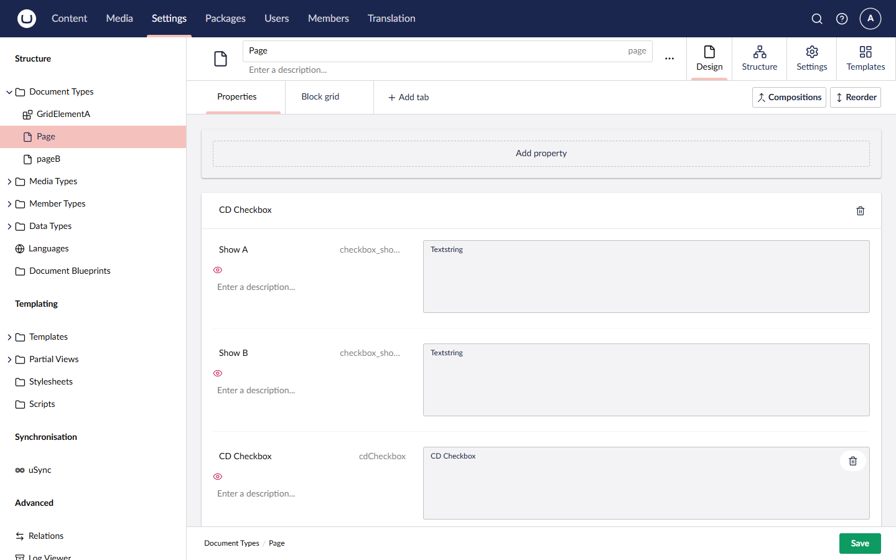
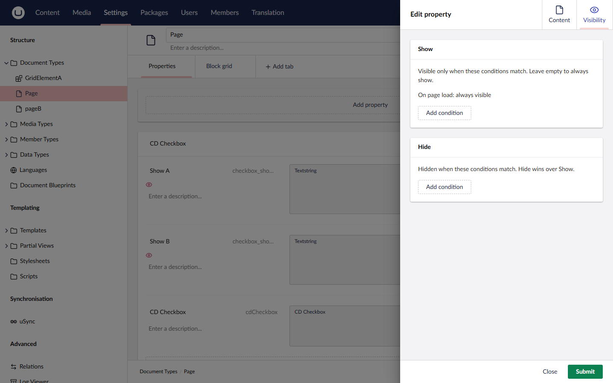
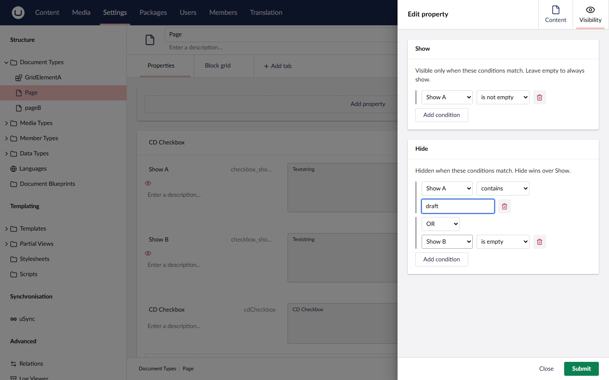
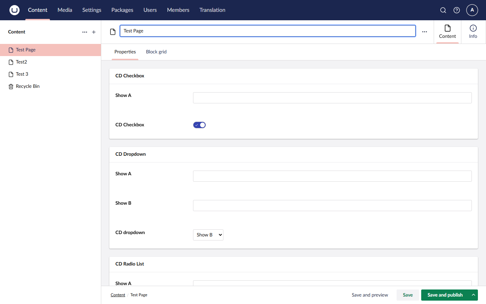
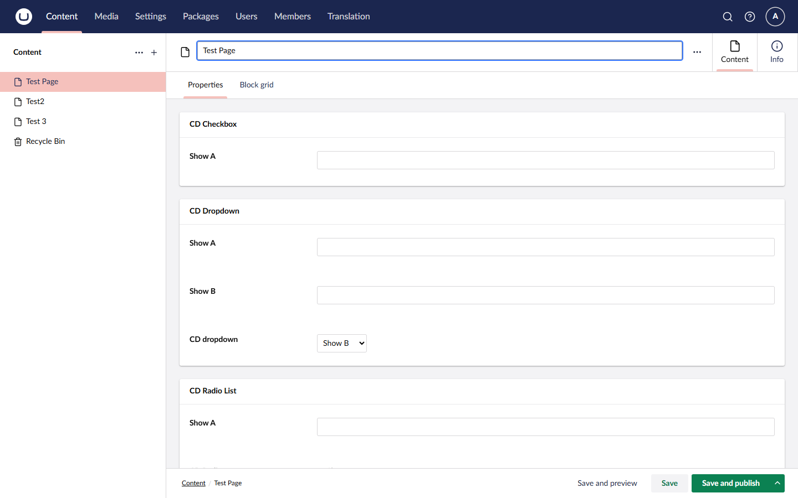

# Conditional Displayers guide

Conditional Displayers lets editors see only the properties that matter. You set **visibility rules** on any property of a document, media, member or element type, and the backoffice shows or hides that property as the editor fills in the others.

This guide covers version 17 and later, for Umbraco 17.

## How it works

- Each property has a **Visibility** tab in its 'Edit property' dialog.
- A rule says 'show this property when these conditions match' or 'hide it when these conditions match'.
- Conditions look at the value of another property on the same content type.
- Rules are stored in the Umbraco database, against the property, and applied live in the backoffice as the editor types.
- Groups and tabs disappear on their own when everything inside them is hidden.

There is nothing to install on the front end and nothing to add to your templates.

## Add a rule

### 1. Open the property

Go to **Settings**, open a document type (or media, member or element type) and click the property you want to control. This is the property that will be shown or hidden, not the one that triggers the change.

A property that already has rules carries a red eye icon under its name, so you can spot them at a glance.



### 2. Open the Visibility tab

In the 'Edit property' dialog, switch to the **Visibility** tab. It has two groups:

- **Show**: the property is visible only when these conditions match. While the group is empty, the property is always visible ('On page load: always visible').
- **Hide**: the property is hidden when these conditions match.



### 3. Add conditions

Select **Add condition** in either group, then pick:

1. **A source property**. Any other property on the same content type, including ones inherited from compositions. A property can't use itself.
2. **An operator**. The choices depend on the source property's type (see the table below).
3. **A value**, where the operator needs one.

Each condition after the first has a connector, **AND** or **OR**.



The rule above reads: show this property when 'Show A' is not empty, but hide it when 'Show A' contains 'draft' or 'Show B' is empty.

### 4. Submit, then save the content type

Select **Submit** to keep your changes, then **Save** the content type. Rules are written to the database when the content type saves. If you select **Close** instead of Submit, the changes are thrown away. If you leave the content type without saving, they are also dropped.

### 5. Check the result

Open a content item of that type. The property now shows or hides as you edit the source property.

| Rule not met | Rule met |
|---|---|
|  |  |

## Operators

| Source property type | Operators | Value |
|---|---|---|
| True/false (toggle) | is ticked, is not ticked | none |
| Dropdown, radio button list, checkbox list, and the Conditional Displayers dropdown and radio | is any of, is none of | pick one or more of the configured items |
| Textstring, textarea | equals, does not equal, contains, is empty, is not empty | text |
| Integer, decimal | equals, does not equal, greater than, less than, greater or equal, less or equal, is empty, is not empty | number |
| Anything else | is empty, is not empty | none |

Text comparisons ignore upper and lower case. A number comparison against an empty or non-numeric value never matches.

## How rules combine

- **Hide wins.** If a Hide condition matches, the property is hidden, whatever Show says.
- **Show is optional.** With no Show conditions, the property is visible unless a Hide condition matches. With Show conditions, it starts hidden and appears when they match.
- **AND binds tighter than OR.** `A OR B AND C` means `A OR (B AND C)`. The tab draws a bar beside each run of AND conditions so the grouping is easy to see.
- **No nesting.** Each group is a flat list.
- **Hidden sources still count.** A condition reads the source property's value even when that property is itself hidden. Rules never depend on other rules, so loops can't happen.

## Groups and tabs

You don't set rules on groups or tabs. A group is hidden automatically when every property in it is hidden, and a tab is hidden when everything in it is hidden. They come back as soon as one property in them is visible again.

In split view, a group or tab hides only when it is empty in every open variant.

## Variants

Rules are evaluated for each variant the editor has open, using that variant's own values. A source property that varies by culture is read from the variant being edited. A source that doesn't vary is read from the shared value.

## Blocks

Block lists, block grids and single blocks work too. Open the block's element type, add rules in the same way, and each block instance is evaluated on its own.

Rules only see properties from the same element. Content properties can use other content properties, and settings properties can use other settings properties. A rule can't look at the page the block sits on.

## Things to know

- **Mandatory properties ignore rules.** A required property can't be hidden, because it would block saving with no way to fix it. If you tick Mandatory, the Visibility tab shows a notice and goes read-only. Your rules are kept, and apply again if you untick Mandatory.
- **Hidden values still save and publish.** Hiding a property only changes what the editor sees. Whatever value it holds stays in the content. To respect the rules on your site or in the Delivery API, see [Getting values in templates](#getting-values-in-templates).
- **Deleted sources are dropped.** If a source property is deleted, its conditions are flagged in the Visibility tab and ignored. If that leaves a Show group empty, the property is visible. The same applies when a property comes from a composition and the source doesn't exist on another document type that uses it.
- **Rules are removed with the property.** Delete a property or content type and its rules go too.

## Upgrading from version 3

Version 17 replaces the old editors with rules. The first start after upgrading runs a one-way migration that:

1. Turns the show and hide settings on your Conditional Displayers data types into visibility rules on the properties they controlled.
2. Expands any `group:` and `tab:` targets into rules on every property in that group or tab.
3. Switches Conditional Displayers checkbox data types to Umbraco's own true/false toggle. Stored values are the same, so no content changes.
4. Strips the old show and hide settings from the radio and dropdown data types. They stay as plain lists of options.

The migration logs how many properties it converted and any alias it couldn't match, so check your log after the first start.

**Behaviour change.** The old editors were stateful: picking a value showed one list of properties and hid another, and left the rest alone. Rules are declarative. A property with Show conditions is hidden whenever none of them match, even if the old configuration never mentioned the current value. Old configurations are nearly always complementary, so most sites won't notice, but check your forms after upgrading.

**uSync will undo the migration.** If you use uSync, your uSync files still hold the old data type settings. The next import writes them back over the migrated data types. After the migration has run, export uSync before the next import.

Content type aliases of the Conditional Displayers editors are unchanged, so existing data types and content keep working.

## Getting values in templates

Reading values doesn't change. The Conditional Displayers radio and dropdown are normal property editors, and the checkbox is now Umbraco's own true/false, so read them as you would any property (strongly typed models, `Model.Value()` and so on).

Rules only hide properties in the backoffice. Your site still renders whatever is stored. If you want the front end to respect the rules too, you have two options.

### Check a property with `IsPropertyVisible`

`IsPropertyVisible` runs the same rules the backoffice does, against the published values of the same item. Add `@using Umbraco.ConditionalDisplayers.Extensions` to your view (or `_ViewImports.cshtml`) first.

```cshtml
@if (Model.IsPropertyVisible("promoBanner"))
{
    <partial name="PromoBanner" model="Model.Value<string>("promoBanner")" />
}
```

It works on content, media, members and block elements, so inside a block list use `block.Content.IsPropertyVisible("alias")` or `block.Settings.IsPropertyVisible("alias")`.

- It returns `true` when the property has no rules, so it's safe to call on any property.
- Hidden source properties still count, the same as in the backoffice.
- Rules on Mandatory properties are ignored, and conditions on a source the item doesn't have are dropped, the same as in the backoffice.
- To get everything hidden on an item in one go, inject `VisibilityService` and call `GetHiddenAliases(content)`.
- Rules are cached per content type. Changes show up straight away on the server that saved them, and within five minutes on other servers in a load-balanced setup.

### Strip hidden properties from the Delivery API

This is off by default, so turning the package on doesn't change your API output. To switch it on, add this to `appsettings.json` and restart:

```json
{
  "ConditionalDisplayers": {
    "DeliveryApi": {
      "StripHiddenProperties": true
    }
  }
}
```

Hidden properties are then left out of `properties` for content, media and block elements, including items the API expands (block lists, pickers and so on). The Management API and the stored content aren't touched.

- A hidden property is missing from the response, not empty. If your front end uses generated types, treat these properties as optional.
- This tidies the output. It isn't a security boundary, because the value is still stored and still reachable by any code that reads it.
- It uses the same rules as `IsPropertyVisible`, so a property is stripped only when `IsPropertyVisible` would return `false` for that item.

## Additional packages

If you use **uSync**, you can export your Conditional Displayers rules by installing [this package](https://www.nuget.org/packages/Our.Umbraco.ConditionalDisplayers.uSync).

If you use **Umbraco Deploy**, you'll need to install [this one](https://www.nuget.org/packages/Our.Umbraco.ConditionalDisplayers.Deploy).


## Contributing

Conditional Displayers is open to anyone who wants to contribute. If you have ideas, feedback or issues, let us know.

- [Issues](https://github.com/skartknet/ConditionalDisplayers/issues)
- [Discussions](https://github.com/skartknet/ConditionalDisplayers/discussions)

To contribute code, fork the repository, clone it and create a branch from `master`. When you're done, push the branch and open a pull request back to `master`.

### Working locally

The solution contains the `ConditionalDisplayers` project (the package itself), the `ConditionalDisplayers.Tests` unit tests and a `TestWebV17` site for manual testing.

```sh
# Client (build before the .NET build)
cd ConditionalDisplayers/Client
npm ci
npm run build

# Test site
dotnet run --project TestWebV17

# Unit tests, then browser tests against the running test site
dotnet test ConditionalDisplayers.Tests
npm run e2e
```

Sign in to the test site's backoffice with:

**Username**: `admin@admin.com`\
**Password**: `Password123`
